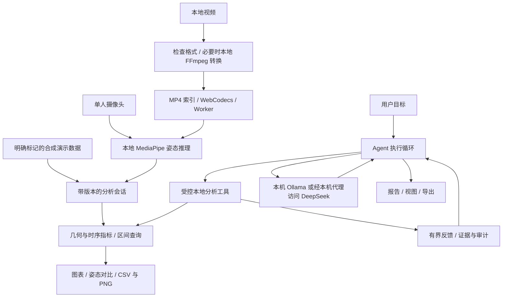

# 系统架构

## 目标与技术栈

Kinetic Pose Lab 是浏览器端通用人体姿态量化分析应用。基础分析在本机完成；可选 Agent 根据用户目标调用分析工具并生成有数值和区间证据的交付物。

| 层次 | 技术与职责 | 代码入口 |
| --- | --- | --- |
| 页面与状态 | Vue 3、TypeScript、Element Plus；采集、分析、对比、导出与 Agent 工作台 | `src/App.vue`、`src/components/`、`src/composables/` |
| 可视化 | ECharts、Canvas；角度、速度、轨迹、区间与关键点展示 | `src/components/TimeChart.vue`、`src/utils/renderer.ts` |
| 本地姿态推理 | MediaPipe Tasks Vision 0.10.32、Pose Landmarker Lite | `src/utils/poseEngine.ts`、`public/pose-inference.worker.js` |
| 视频准备与解码 | FFmpeg WebAssembly、MP4Box 2.5.0、WebCodecs、Worker | `src/video/prepare.ts`、`src/video/mp4.ts`、`src/video/offline.worker.ts` |
| 分析与导出 | 会话版本、帧索引、几何计算、工具反馈与 CSV/PNG | `src/analysis/`、`src/utils/poseMath.ts`、`src/utils/csvExport.ts` |
| Agent | 模型适配、任务规格、受控工具循环、证据、审计与评测 | `src/agent/` |
| 本机服务 | Vite 开发/生产预览、DeepSeek 回环代理、进程健康检查 | `vite.config.ts`、`scripts/deepseek-proxy.mjs` |
| 工程检查 | pnpm 锁文件、TypeScript、ESLint、Prettier、Node Test、Playwright | `package.json`、`tests/`、`.github/workflows/check.yml` |

依赖声明在 `package.json`，完整解析版本在 `pnpm-lock.yaml`；运行环境见 [环境配置](environment.md)。

## 数据流

摄像头与离线视频采用各自的采集链路。视频转换在独立 Worker 中执行；解码与推理使用暂停、恢复、确认和取消消息控制执行，时间轴审计用于记录完整性。视频详情见 [离线视频](offline-video.md)。

## 分析与 Agent 的边界

关键点经过阈值、滤波和几何计算生成角度、速度、轨迹等通用指标。会话、参数和修订号共同约束工具证据；输入或参数变化时，旧分析结果与视图需要失效，避免沿用过期结论。详见 [分析契约](analysis-contract.md)。

Agent 使用模型提供的工具调用，交由本地运行时校验和执行，再将有界结果反馈给模型。报告、视图和导出与实际工具证据关联；运行时保留执行审计。Ollama / DeepSeek 共用模型适配接口，详见 [Agent 运行时](agent-runtime.md) 和 [控制协议](agent-control-protocol.md)。

## 运行与部署

- `pnpm dev` 运行本机 Vite 开发服务；`pnpm build` 校验资源、检查类型并生成 `dist/`；`pnpm preview` 提供本机生产预览。
- MediaPipe、Lite 模型和 FFmpeg 资源由 `pnpm prepare:assets` 准备到 `public/`，随构建复制；模型哈希与上游包字节由 `pnpm check:assets` 检查。
- `dist/` 可部署到根路径 HTTP 静态服务。当前资源使用绝对根路径，仓库子路径部署需要另行适配。
- DeepSeek 代理只存在于本项目的本机开发或生产预览服务中。纯静态站点没有该代理；密钥保留在 Node 环境中。
- 视频和画面留在浏览器；选择外部模型时，用户指令和必要的分析工具反馈会发给所选服务。审计保存在本机浏览器 IndexedDB。

## 当前实现边界

最多保留 18,000 帧，单视频上限 500 MB。多格式支持受编码、文件完整性和设备内存影响，转换后最大画幅为 1920×1080。系统不识别运动种类、不评分、不判断动作对错。二维投影和遮挡会影响指标；双视频对比仍为预览功能，不能据其距离给出严格序列相似度结论。

确定性测试使用合成视频和脚本化模型响应；真实人体精度、设备表现与真实模型效果需要独立验收。检查结果和限制见 [构建与交付](delivery.md)。
